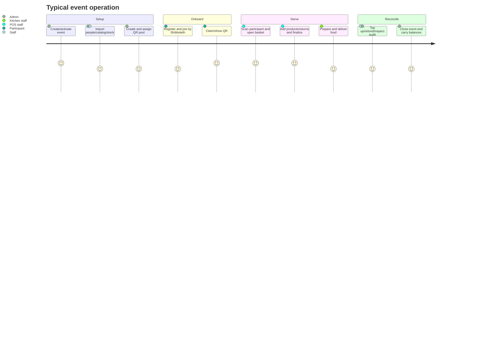

# Project Overview

## Product purpose

Kasszás Erzsi exists to run the financial and catering operations of a temporary camp-like event without cash changing hands at each sale. Participants preload value, staff charge an internal balance, and the system keeps sales, kitchen work, deposits, inventory, and refunds synchronized. The interface and domain vocabulary are Hungarian; monetary values are integer HUF.

**Confirmed:** the current code names the PWA “Kasszás Erzsi,” calls guests `Vendég`, POS staff `Büfés`/`Beugrós`, top-up workers `Paku`, participants “personas,” and participant types `gólya` (freshman) and `animátor` (organizer).

## Product boundary

The repository contains the complete web client, callable backend, database rules/indexes, Firebase deployment configuration, staging seed, and bespoke test scripts. It does not contain payment-processor integration, cash-register hardware integration, e-mail/SMS delivery, a separate API server, or a data warehouse. “Top-up” changes an internal balance; the code does not record how external money was collected.

## Users and roles

### Participant (`user`)

Registers with name, Shibboleth, e-mail, and password. Can browse a read-only, category-filtered menu for the active event before linking a participant profile. After joining the event, sees profile and balance, receives/displays a personal QR code, reviews order history, and follows the latest undelivered food order. A linked participant can self-claim an unused QR.

### POS worker (`pos_staff`)

Searches or scans a participant, holds an exclusive basket lease, scans products, customizes food, accepts DRS/cup returns, finalizes/refunds orders, marks products temporarily unavailable, and works the kitchen board. Cannot manage the catalog or people directory through intended UI/routes.

### Staff (`staff`)

Has POS/kitchen capabilities plus people, product, modifier-template, and stock administration. Does not receive admin-only account, event, QR-pool, global analytics, or audit screens.

### Head counter worker (`head_pos`, Főbüfé)

Can use the POS, manage the catalog and stock, and view event statistics on a separate page. Cannot access the top-up, kitchen, people-management, or admin pages.

### Top-up worker (`topup_staff`)

Can read the participant/account directory required for lookup and invoke the server-side positive top-up operation. It cannot sell, refund, or make arbitrary negative/manual adjustments.

### Administrator (`admin`)

Creates and closes events, configures negative-purchase behavior, manages privileged accounts and all attendee/QR links, runs bulk/manual balance adjustments, views audit and analytics, and inherits all other roles' operational capabilities.

## Major concepts

| Concept | Meaning |
| --- | --- |
| Event | Isolated operating period; exactly one is intended to be active globally |
| Person/persona | A participant's event-local operational identity and balance |
| Account | Firebase-authenticated, cross-event login identity |
| Event link | Mapping from an account to one person in an event |
| Shibboleth | Normalized participant identifier used to self-join and carry balance between events |
| QR credential | Event-local four-digit token mapped to a person |
| Basket | Mutable, leased POS draft keyed by person ID |
| Order | Immutable-at-creation transaction snapshot, later annotated by kitchen/refunds |
| Ledger entry | Balance delta with before/after values and reason |
| DRS | Hungarian bottle/can deposit; fixed at 50 HUF per unit in code |
| Repohár | Reusable cup; returns are credited at 1,000 HUF per unit |
| Stock recipe | Product-to-stock consumption rule, optionally containing choice groups |

## Capabilities and rules

### Events

- Statuses are `draft`, `active`, and `closed`.
- The UI prevents activating a second event while another is active.
- A new event may clone modifier templates, products, barcode indexes, and stock-item definitions; cloned stock quantities start at zero.
- The active event is selected by `system/runtime.activeEventId`.
- Closing requires the event itself to be active. Any nonzero-balance participant without Shibboleth, or any duplicate normalized Shibboleth among active people, blocks closure.
- Closure writes positive, zero, and negative balances to global carryover records.

### People and accounts

- Imported people require a name and attendee type; team and Shibboleth may be blank at import, though a nonzero balance without Shibboleth later blocks closure.
- People are soft-deleted. Deletion removes the account link, revokes the assigned QR, and prevents POS/top-up; restoration does not restore those links.
- One account has at most one event-link document per event. Relinking it clears the previous person's account reference.
- One person is intended to link to at most one account.
- Self-join by Shibboleth requires exactly one active matching person and rejects a person already linked to someone else.

### Balances

- Amounts are integer HUF.
- Positive top-up is a privileged Cloud Function for `admin` or `topup_staff`.
- Admin manual adjustment may be positive or negative; bulk adjustment is server-side, chunked, and correlation-ID based.
- Checkout debits the person's current balance within a transaction.
- Normally, a positive purchase cannot make the balance negative.
- If `allowSingleNegativePurchase` is enabled, a non-negative person may cross below zero once; any later positive purchase is blocked while the starting balance remains negative.
- A negative-total return-only basket credits the balance.

### QR and barcode identity

- Person QR codes are exactly four numeric digits (`1000`–`9999` for generation).
- Product barcodes must be numeric and cannot be four digits.
- QR URLs always point to `https://kasszaserzsi.hu/qr/{code}`, including credentials made in staging.
- QR states are unassigned, assigned, or revoked. Revoked codes cannot be reused through the normal flows.
- An assigned QR must be revoked before it can be deleted; only unassigned/revoked pool items can be deleted.

### POS and orders

- Only active, not temporarily unavailable products are sellable through normal UI.
- A basket belongs to a Firebase UID plus a browser-local random session ID.
- The lease becomes stale after 45 seconds; the POS refreshes it every 15 seconds. Taking over a stale open basket discards its contents.
- Navigation/sign-out warns about an active basket and offers cancel/finalize.
- DRS products automatically add deposit lines. Bottle and cup returns are synthetic negative-price lines.
- Reusable-cup returns are capped in UI by historical purchases minus returns/refunds, plus cup purchases in the current basket.
- Finalization snapshots all product/customization fields and deletes the basket in the same transaction, preventing double finalization.
- Partial and full refunds credit balance, update refunded quantities/totals, restore recipe stock, and append ledger/audit records.

### Kitchen

- Food is category `Kaja` (legacy `food` values normalize to it).
- Product name/template patterns classify food into burger, gyros, pizza, or other.
- Each station progresses through `new → preparing → ready → delivered` in UI.
- The stored order-level status remains the least advanced station until all are delivered.
- Delivered tickets remain visible for 90 seconds. The kitchen can be globally opened/closed through an event flag.
- Queue workload thresholds and wait estimates are display heuristics, not persisted commitments.

### Catalog and stock

- Products have category, integer price, active/unavailable flags, optional DRS/modifier template, barcodes, and stock recipe.
- Barcode index documents enforce fast lookup and intended uniqueness.
- Stock units are piece or milliliter; quantities may fall below zero because checkout does not reject insufficient stock.
- Checkout subtracts recipe quantities; refund restores them. Missing recipe targets produce movement records with null before/after values rather than blocking the sale.

## Main product workflows

## Product constraints

- It assumes trusted event staff and online Firebase access, with Firestore offline persistence as a convenience rather than a designed offline-first reconciliation protocol.
- The four-digit QR namespace contains only 9,000 possible values per event.
- Product/category/station recognition contains language- and naming-dependent rules.
- One active event is a convention guarded by UI/Functions, not a database uniqueness constraint.
- There is no recorded exchange between cash/card and top-up value, so financial reconciliation outside the internal ledger requires an external process.

## Evidence classification

Unless noted otherwise, statements above are **Confirmed** by current source, Rules, configuration, or tests. Product-market motivation (“camp-like temporary events”) is **Strongly implied** by UI copy, account labels, the original README, and seed data. The exact organization, event size, financial/legal process, and production operating procedures remain **Uncertain**.

