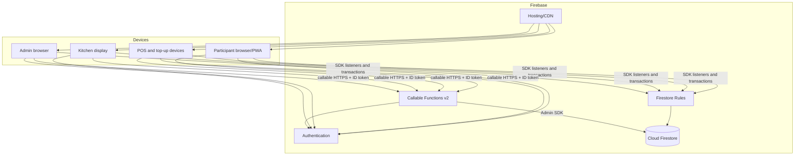
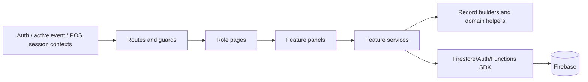
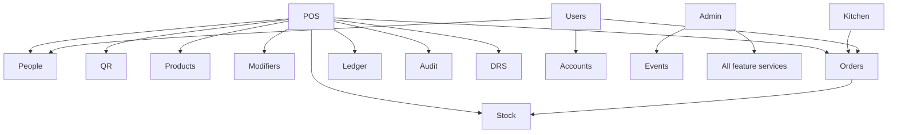

# Architecture

## System architecture

The system is a Firebase-hosted modular frontend with serverless privileged functions. It is not a traditional three-tier API application: browser feature services call Firestore directly and embed significant application/domain logic. The security boundary is a combination of Firebase Authentication, Firestore Security Rules, and callable Function checks.



### Runtime components

| Component | Responsibility | Communication |
| --- | --- | --- |
| React PWA | UI, routing, subscriptions, imports/exports, POS/application logic | Firebase Web SDK, browser camera/keyboard, local storage |
| Firebase Auth | E-mail/password identity and custom role claims | Firebase Auth protocol / ID tokens |
| Cloud Firestore | All persistent business state and real-time fanout | Firestore SDK/WebChannel |
| Security Rules | Authorize and partially validate direct client operations | Evaluated on each Firestore request |
| Cloud Functions | Auth admin and privileged transactional workflows | Firebase callable HTTPS; Admin SDK |
| Firebase Hosting | Static SPA/PWA delivery and route fallback | HTTPS/CDN |

No queue, scheduler, webhook receiver, object storage use, background worker, WebSocket server, or custom REST/GraphQL endpoint exists. Firestore listeners provide the live-update behavior.

## Frontend application architecture



### Shell and routing

`src/main.jsx` configures PWA behavior and mounts React. `src/app/AppProviders.jsx` nests Auth, active-event, and POS-session contexts. `src/app/AppRoutes.jsx` maps role-specific pages. `src/app/RouteGuards.jsx` provides usability guards only; it redirects but does not secure data.

`src/app/AppShell.jsx` supplies navigation, environment/event labels, full-screen/header shortcuts, logout, and a guard around navigation when a device owns an open basket.

### Feature organization

Feature directories usually contain:

- a UI page/panel or hook;
- a `*Service.js` that calls Firebase and often owns transactions;
- a `*Models.js` that constructs Firestore-shaped records and holds calculations/constants.

This resembles a feature-sliced modular monolith, but boundaries are porous. For example checkout imports order, ledger, audit, DRS, QR, people, and stock modules. Large UI panels also contain domain logic, parsers, scanner state machines, and import formats.

### State management

There is no Redux-like store. State comes from:

- React local state for forms, selection, and transient workflows;
- Context for Auth, active event, and the current POS basket interface;
- Firestore `onSnapshot` listeners for server state;
- `localStorage` for the POS device session ID and kitchen display preferences;
- IndexedDB persistence enabled by Firebase for cached Firestore data;
- service-worker caches for production static assets.

## Backend application architecture

`functions/index.js` is a single Cloud Functions module. It contains validation, authorization helpers, record builders duplicated from the client, and 16 callable exports. It uses one initialized Admin SDK client and global settings (`europe-west1`, maximum 10 instances, explicit CORS origins).

The backend has no controller/service/repository split. Each callable parses input, checks role, runs Admin SDK reads/transactions, and creates audit/ledger data inline. This keeps deployment simple but concentrates unrelated domains and makes independent testing difficult.

## Persistence boundary

Firestore paths are centralized for the client in `src/lib/firestorePaths.js`; Functions reconstruct paths locally. All event operational data sits under `events/{eventId}`. Global collections hold accounts, carryover balances, and runtime selection.

```mermaid
flowchart TB
  Accounts[accounts/{uid}] --> Links[eventLinks/{eventId}]
  Runtime[system/runtime] --> Event[events/{eventId}]
  Carry[carryoverBalances/{normalizedShibboleth}]
  Event --> People[people]
  Event --> Products[products / productBarcodes]
  Event --> Modifiers[modifierTemplates]
  Event --> Commerce[baskets / orders]
  Event --> Money[ledgerEntries / auditLogs]
  Event --> Ops[qrAssignments / drsReturns / stockItems / stockMovements]
  Links -. personId .-> People
  Carry -. applied by Shibboleth .-> People
```

## Representative request/data flow

```mermaid
sequenceDiagram
  actor Staff
  participant UI as StaffPosPanel
  participant PS as posService
  participant Rules as Firestore Rules
  participant DB as Firestore
  Staff->>UI: Finalize basket
  UI->>PS: finalizeBasket(event, person, session)
  PS->>Rules: transactional reads
  Rules->>DB: basket, person, event, stock
  DB-->>PS: current snapshots
  PS->>PS: verify lease, calculate totals/balance/stock
  PS->>Rules: transactional writes
  Rules->>DB: order + balance + ledger + audit + return + stock; delete basket
  DB-->>PS: commit or retry/fail atomically
  PS-->>UI: order ID and resulting balance
  DB-->>UI: real-time subscription updates
```

## Communication and consistency

- Firestore listeners are the only push mechanism.
- Firestore transactions serialize contested participant balances, basket leases, refunds, and stock updates.
- Write batches group operations that do not need read-dependent calculation.
- There is no general idempotency layer. Basket deletion makes checkout retry-safe after a successful commit. Bulk balance adjustment uses a correlation ID, though its check-and-process protocol is not itself atomic across concurrent invocations.
- Multi-batch imports/clears and catalog cloning can partially complete.

## Architectural decisions

### Client-heavy serverless architecture

**Confirmed.** Most services import `db` directly. Benefits are rapid development, real-time UI, low operational overhead, and offline cache support. Limitations are duplicated trust logic, broad Rules, large client bundles, and difficulty enforcing multi-document invariants centrally.

### Event-scoped subcollections

**Confirmed.** Operational data is naturally isolated and archived per event. It simplifies active-event listeners and historical selection, but cross-event reporting and uniqueness require application logic. Shibboleth carryover is a deliberate global bridge.

### Snapshot-based orders

**Confirmed.** Order lines preserve product names, prices, customizations, and consumption. Historical correctness survives catalog edits, at the cost of denormalization and client-side reporting.

### Append-oriented ledger/audit beside mutable balance

**Confirmed.** A person document provides fast current balance while ledger/audit records explain changes. Benefits are fast POS reads and traceability; limitation is that permissive direct writes can allow them to diverge.

### Synchronous kitchen workflow through order documents

**Confirmed.** No queue service exists. Per-station status maps live directly on orders and real-time listeners drive displays. This is appropriate for modest event workloads but broadcasts growing collections to clients.

### Browser-side analytics and imports

**Confirmed.** Recharts and SheetJS operate over subscribed collections. This avoids backend jobs, but memory/network cost grows with event history and calculations depend on client code/version.

### PWA auto-update

**Confirmed.** Production registers Workbox with `skipWaiting`, `clientsClaim`, periodic update checks, and noncached entry artifacts. Staging unregisters service workers to avoid stale demo bundles.

## Internal dependencies



## Important implementation references

| Concept | Primary implementation | Related areas |
| --- | --- | --- |
| App composition/routes | `src/app/` | `src/main.jsx`, `src/App.jsx` |
| Firebase clients | `src/lib/firebase.js` | `.env*.example` |
| Active event | `src/features/events/` | `system/runtime`, event callable |
| Checkout | `src/features/pos/posService.js` | basket/order/stock/ledger models |
| Kitchen | `src/features/kitchen/` | `orderService.js`, `orderModels.js` |
| Participants/carryover | `src/features/people/`, `functions/index.js` | accounts, events |
| Security boundary | `firestore.rules`, `functions/index.js` | route guards, custom claims |
| Data paths/indexes | `src/lib/firestorePaths.js` | `firestore.indexes.json` |
| Deployment | `firebase.json`, `.firebaserc`, `vite.config.js` | package scripts |

