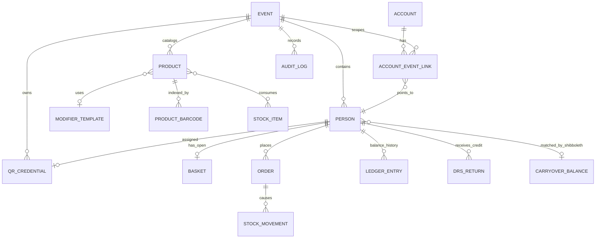

# Data Model and Persistence

## Persistence model

Cloud Firestore is the only database. The client uses plain JavaScript objects and record-builder functions; there is no ORM, formal schema registry, or migration framework. Security Rules supply partial runtime shape validation. Server timestamps are used for most writes, while some nested refund metadata uses client milliseconds.

## Entity relationship model

Firestore does not enforce these foreign keys. Relationships are document IDs/fields maintained by application transactions and batches.

## Global documents

### `accounts/{uid}`

Cross-event login profile. Important fields: `uid`, `email`, `displayName`, raw/normalized Shibboleth, `role`, `status`, creator/disable metadata, timestamps. UID equals Firebase Auth UID. The Auth custom claim is the primary effective role; Firestore role is a fallback and directory representation.

**Invariant:** normal users may create only their own active `user` account and cannot change UID/e-mail/role/status. Admin Functions synchronize privileged Auth claims and account role, but there is no repair job for partial failure between them.

### `accounts/{uid}/eventLinks/{eventId}`

Denormalized map to a person: event/person IDs, linked UID/by/time, display metadata, Shibboleth. Owned by the account but writable only by admin via Rules/Admin SDK. Participants read their own link to discover their event person.

### `system/runtime`

Singleton containing `activeEventId`, updater, timestamp. It is a global routing/configuration pointer, not a lock enforcing uniqueness.

### `carryoverBalances/{normalizedShibboleth}`

Latest cross-event balance for one normalized Shibboleth, with source event/person and close metadata. Closure overwrites it; person records store `carryoverAppliedFromEventId` to prevent reapplication.

## Event root

### `events/{eventId}`

Fields include name/code/normalized name, status, start/activation/close metadata, `allowSingleNegativePurchase`, and `isKitchenClosed`. Event ID is random; code is display/search metadata and is not enforced unique.

Lifecycle: draft → active → closed. The implementation can reactivate a closed event through the generic activation patch, although intended UI may not offer every transition.

## Event subcollections

### `people/{personId}`

Event-local participant and authoritative current balance. Fields include generated internal ID, display/search fields, team/type, raw/normalized Shibboleth, linked account IDs, QR IDs/link, integer balance, record status, carryover stamp, and timestamps.

Representations of a person also appear in account event links, baskets, orders, DRS returns, audit details, and analytics maps. Those are snapshots and can become stale after a profile edit.

Lifecycle: active ⇄ deleted. Deletion clears identity links but preserves orders, ledger, and the person document.

### `qrAssignments/{code}`

QR pool and assignment state. The document ID is the four-digit code. Duplicate compatibility fields exist (`assignedPersonaId`/`personId`, `assignedAccountId`/`linkedAuthUid`, `qrId`/`code`). Status is `unassigned`, `assigned`, or `revoked`. Revocation is terminal under normal workflows.

### `products/{productId}`

Catalog record: name/search form, normalized category, integer HUF price, active/unavailable flags, DRS flag, template ID, barcode array, embedded stock recipe, timestamps. Orders copy product data rather than referencing live values for history.

### `productBarcodes/{barcode}`

Reverse lookup: barcode, product ID/name, updater/time. Document identity is the uniqueness mechanism. A product save transaction keeps it synchronized; partial bulk imports can leave inconsistencies if a later chunk fails.

### `modifierTemplates/{templateId}`

Reusable food customization definition with embedded ingredient and extra arrays. Item IDs are browser UUIDs. Extras store price and max quantity.

### `stockItems/{stockItemId}`

Named inventory with unit (`piece` or `ml`), integer current quantity, threshold, active flag, and update metadata. Recipes refer to stock item IDs and also snapshot names.

### `stockMovements/{movementId}`

Append-oriented stock delta: item/name/unit, before/after, type (`manualAdd`, `manualCorrection`, `sale`, `refund`), reason, optional order/line/product references, actor, timestamp. Missing referenced stock during sale/refund produces a movement with null balance fields.

### `baskets/{personId}`

One open POS draft per person. It stores participant display snapshots, status `open`, normalized line array/totals, and lease owner UID/session/name with opened/updated timestamps. Document deletion is the closed/cancelled state.

### `orders/{orderId}`

Finalized commerce snapshot. Fields include person snapshots, status `finalized`, line array, gross/refunded/net amounts, refund history, DRS counts, food flags/status, per-station maps and update actors/times, creator, timestamps.

Order line types:

| `lineType` | Meaning | Price sign |
| --- | --- | --- |
| `product` | Catalog product/customized food | Usually nonnegative |
| `drs` | Deposit attached to DRS product | +50 HUF |
| `drsReturn` | Bottle/can return | -50 HUF |
| `reusableCupReturn` | Cup return | -1,000 HUF |

Product lines snapshot `stockConsumption` and customization so refunds can restore the originally consumed inventory.

### `ledgerEntries/{entryId}`

Balance delta with type (`topup`, `manualAdjustment`, `sale`, `refund`, `drsReturn`, `carryoverIn`), actor/person, amount, before/after, HUF, reason/correlation ID, timestamp. Current balance is not derived from ledger at read time.

### `auditLogs/{entryId}`

Operational audit event: type, actor, summary, target type/ID, optional person, arbitrary details, timestamp. Details may contain complete order items, balance changes, import counts, and state transitions.

### `drsReturns/{returnId}`

Completed bottle-return event with participant snapshot, quantity, 50-HUF unit amount, total credit, balance before/after, actor/name, notes, timestamp. DRS sales are inferred separately from order deposit lines.

## Transient client state

- Auth/account/claims and active event live in React contexts.
- POS form/basket draft exists in component state and is mirrored to the basket document.
- Scanner buffers, dialogs, import parse results, selected filters, and analytics aggregates are client-only.
- POS session ID and kitchen filter/audio preferences persist in `localStorage`.
- Firebase caches documents in IndexedDB; this is not a separate source of truth.

## Indexes

`firestore.indexes.json` defines descending composite indexes for:

- DRS returns by person and time;
- orders by DRS flag and time;
- orders by food flag and time;
- orders by person and time.

Other simple ordered queries rely on Firestore automatic indexes. Any new `where + orderBy` combination may require an explicit deployment.

## Transactions and guarantees

| Operation | Mechanism | Guarantee |
| --- | --- | --- |
| Checkout | Client Firestore transaction | Basket/person/event/stock read consistency; all writes or none |
| Partial/full refund | Client transaction | Order, balance, ledger/audit, stock change together |
| DRS return | Client transaction | Credit, ledger, DRS, audit together |
| Top-up | Admin SDK transaction | Balance, ledger, audit together |
| QR/link/self-join | Admin SDK transaction | Denormalized relationship updates together |
| Event close | Admin SDK transaction | Carryover, event, runtime, audit together, subject to limits |
| Product save | Client transaction | Product/barcode indexes/audit together |
| Imports/clones/clear | Multiple batches | Only each batch is atomic; whole operation may be partial |

## Retention and deletion

No TTL, scheduled cleanup, backup policy, or archival process is configured. People are soft-deleted; products/templates/QR pool items may be hard-deleted. Orders, ledger entries, stock movements, DRS returns, and audit logs have no delete UI/retention policy. Deleting an event is allowed to admins by Rules, but no recursive deletion implementation is present; deleting a Firestore parent does not delete subcollections.

## Schema evolution

Compatibility fields and fallbacks show in-place evolution:

- old/new QR person/account field names;
- legacy product category mappings;
- old single kitchen `foodStatus` plus new per-station maps;
- optional `personDisplayId` snapshots;
- runtime self-healing after missing/partial state.

There are no migrations. Readers and writers carry compatibility logic, which must be preserved or replaced by an explicit migration.

