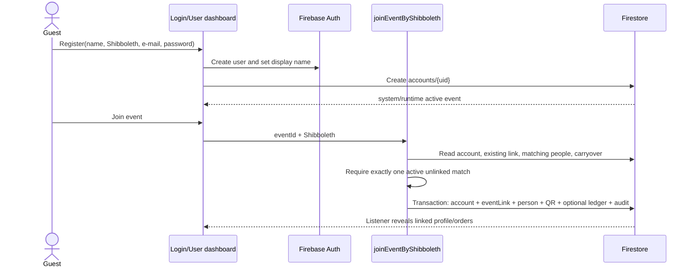
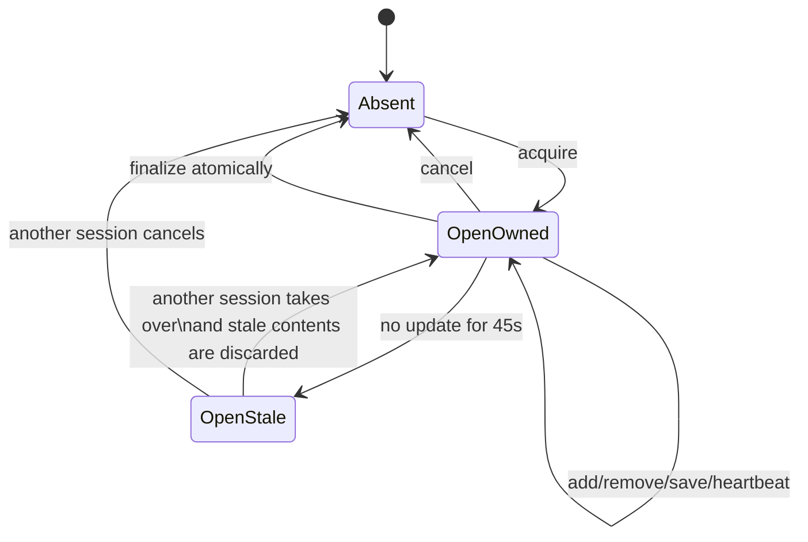
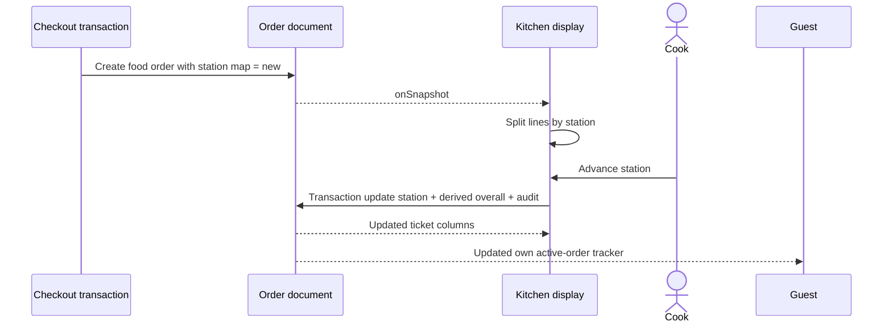
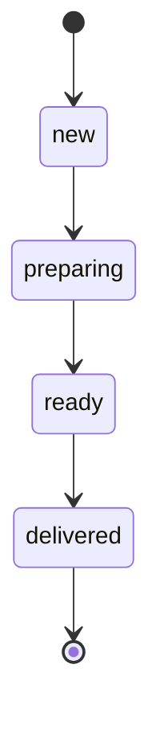
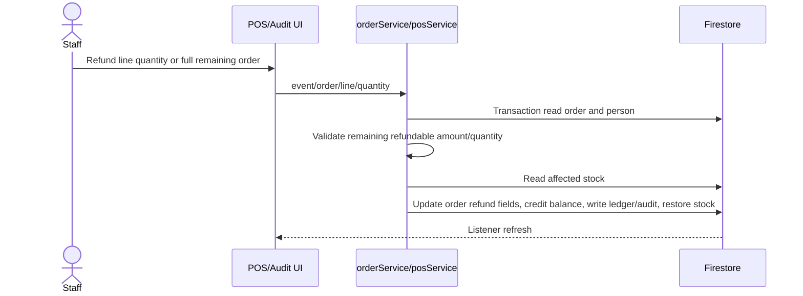
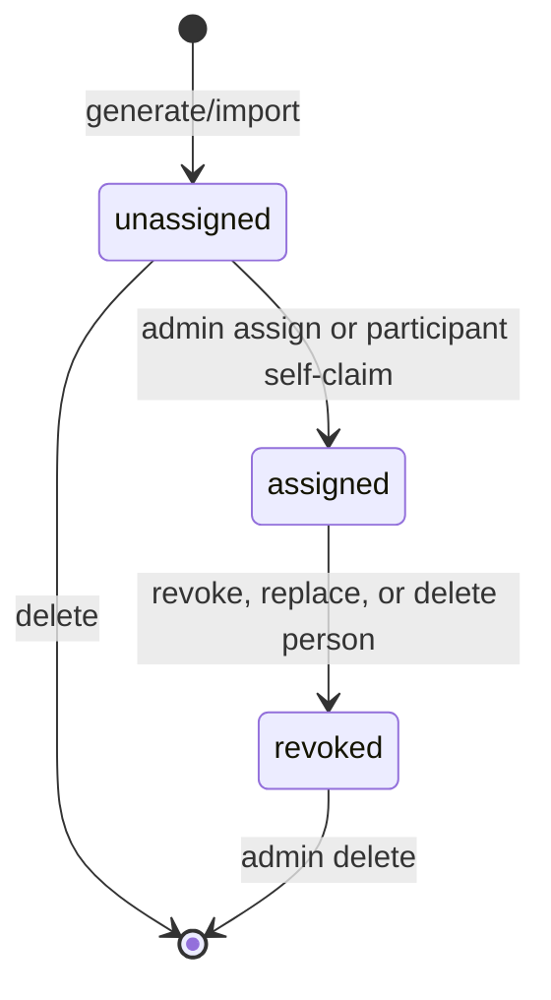
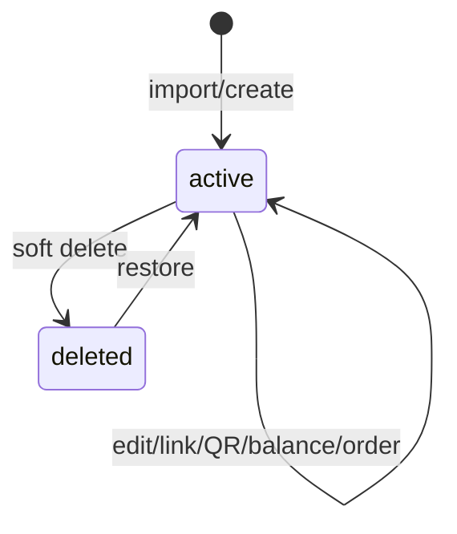
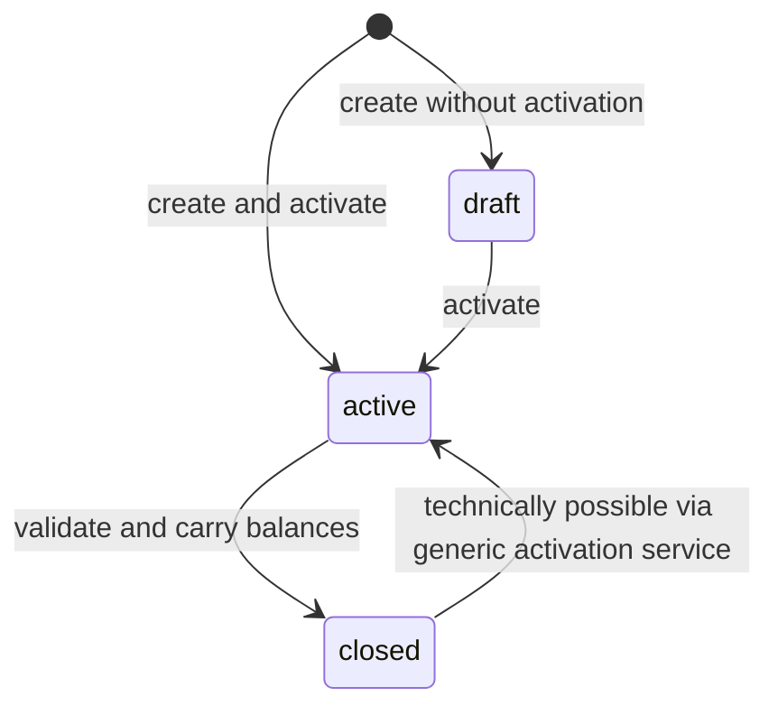
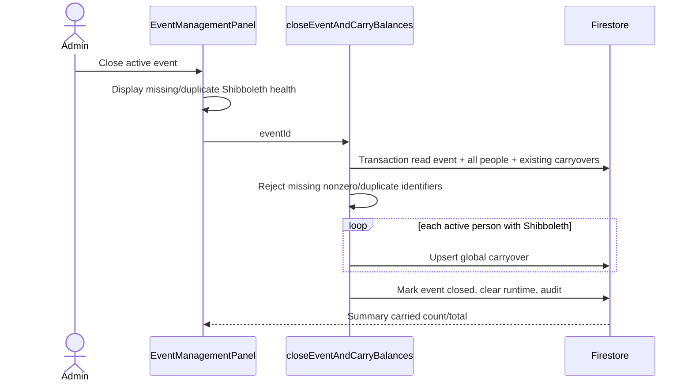
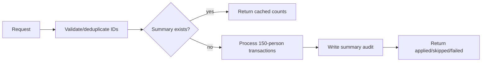

# Workflows and State Machines

## Participant onboarding



**Preconditions:** authenticated account, active event, exactly one non-deleted person with matching normalized Shibboleth. **Side effects:** denormalized links, possible one-time carryover credit, QR account metadata, audit. **Recovery:** admin can fix duplicate/missing identifiers or relink manually.

## POS sale

```mermaid
sequenceDiagram
  actor Cashier
  participant POS as StaffPosPanel
  participant QR as resolveAssignedQrCredential
  participant DB as Firestore
  Cashier->>POS: Scan/search participant
  opt QR scan
    POS->>QR: eventId + code
    QR->>DB: Read credential and person
    QR-->>POS: Person
  end
  POS->>DB: Transaction acquire basket lease
  Cashier->>POS: Scan/add/customize products and returns
  POS->>DB: Debounced transaction save basket
  loop every 15 seconds
    POS->>DB: Refresh lease
  end
  Cashier->>POS: Finalize
  POS->>DB: Transaction read basket/person/event/stock
  POS->>POS: Validate owner, totals, negative-balance rule
  POS->>DB: Write order, person, ledger, audit, DRS, stock movements; delete basket
  DB-->>POS: Commit/order ID/balance
  DB-->>Cashier: Real-time UI reset
```

### Checkout invariants

- Person exists and is active.
- Basket exists, contains lines, and is owned by caller session or stale.
- Totals are recalculated for normalized items, although an already stored `basket.totalAmount` takes precedence when non-null.
- Starting negative balance blocks positive purchases.
- Crossing below zero is allowed only when event flag is enabled and start was nonnegative.
- Balance/order/ledger/audit/stock/basket mutation is one transaction.

### Failure paths

Lock conflict, empty basket, missing person, insufficient balance, or transaction failure leaves the basket intact. A committed transaction deletes it, so a retry cannot finalize twice. Missing stock records do not fail checkout. Network loss interacts with Firestore offline behavior; no explicit pending-write reconciliation UI is documented.

## Basket state



There is only one persisted basket status (`open`); absence represents cancelled/finalized. The UI also starts a 60-second abandonment cancellation timer.

## Kitchen fulfillment





The diagram is the intended UI progression. **Confirmed:** the service accepts any allowed next status and does not enforce adjacency or terminality, so reverse/jump transitions are technically possible. Multi-station overall status is the least advanced station; only all-delivered yields overall delivered.

## Refund



Orders remain `finalized`; refund lifecycle is expressed by `refundedQuantity`, `refundedTotal`, `netAmount`, and history rather than a separate status.

## QR lifecycle



Revoked → assigned is disallowed. Deleting an assigned credential is disallowed. Replacing a person's QR revokes the previous credential.

## Person lifecycle



Delete removes account and QR associations. Restore does not recreate them. Deleted people cannot be used in POS, top-up, QR assignment, self-join, or carryover close population.

## Event lifecycle and carryover





### Carryover application points

Carryover may be applied during person import, person Shibboleth edit, admin account link, or participant self-join. Each stamps the source event on the person. The stamp prevents the same source from applying twice. Close also rescues a previous carryover that appears not to have been applied.

## Bulk balance adjustment

The UI generates one correlation ID per confirmation. The Function first searches for a completed summary. If absent, it processes groups of 150, each transaction reading people then writing person + ledger + per-person audit. It finally writes a summary. Partial chunk failures are returned.



The idempotency check and summary write are separate, so it protects ordinary retries after completion, not simultaneous duplicate invocations.

## Catalog/stock import

Files are parsed in the browser. Product import may first upsert/create stock items, then create products/barcode indexes in later batches, then write an audit record. Consequently this is a saga without compensation: a later failure can leave stock but no product, or some products but no summary audit. Product saves outside import are transactional.

## Concurrency summary

| Shared resource | Protection | Remaining concern |
| --- | --- | --- |
| Person balance | Firestore transactions | Broad staff Rules permit out-of-band writes |
| Basket | UID+session lease in transaction | 45-second takeover; offline/pending behavior unclear |
| Checkout duplication | Basket delete in same transaction | No external idempotency key needed for committed retry |
| Stock | Included in checkout/refund transaction | Negative stock allowed; missing items tolerated |
| QR assignment | Admin SDK transaction | Four-digit namespace exhaustion eventually possible |
| Account-person link | Admin SDK transaction | Auth/account operations elsewhere are not atomic |
| Bulk balances | Per-chunk transactions + summary lookup | Concurrent same-correlation race; partial operation |
| Event activation | Batched client check/write | No database uniqueness invariant for active event |

