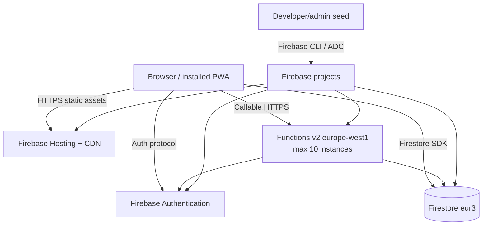

# Infrastructure and Deployment

## Production topology



There are no Dockerfiles, Compose/Kubernetes resources, Terraform, reverse proxy, custom server, persistent volume, or repository CI workflow.

## Environments

| Environment | Firebase alias/project | Vite mode | PWA behavior |
| --- | --- | --- | --- |
| Production | `prod` → `erzsi-2` | `production` | Service worker registered and auto-updated |
| Staging | `staging` → `erzsi-2-staging` | `staging` | Existing service workers unregistered |
| Local default | `npm run dev` uses staging | `staging` | Vite at `0.0.0.0:3000` |
| Preview | built output | chosen build mode | `0.0.0.0:4173` |
| Firestore tests | `erzsi-2-test`/test config | Node scripts | Emulator at `127.0.0.1:8080`, UI `4000` |

Production and staging are intended to be completely separate Firebase projects. The build embeds whichever web-app configuration is present for the selected Vite mode; pointing staging variables at production is a high-risk misconfiguration.

## Configuration

### Browser build variables

| Variable | Required | Purpose |
| --- | --- | --- |
| `VITE_APP_ENV` | Recommended | Select staging-specific service-worker behavior |
| `VITE_APP_ENV_LABEL` | Optional | Displays the demo/environment badge |
| `VITE_FB_API_KEY` | Yes | Firebase Web API identifier |
| `VITE_FB_AUTH_DOMAIN` | Yes | Firebase Auth domain |
| `VITE_FB_PROJECT_ID` | Yes | Target project/database |
| `VITE_FB_STORAGE_BUCKET` | Configured, not currently used | Firebase app config |
| `VITE_FB_SENDER_ID` | Yes for app config | Firebase messaging sender identifier; messaging is not used |
| `VITE_FB_APP_ID` | Yes | Firebase web app ID |
| `VITE_FB_MEASUREMENT_ID` | Present only in staging file; unused in code | Analytics identifier, no analytics initialization |

`.env.example` and `.env.staging.example` are tracked; populated `.env`, `.env.production`, and `.env.staging` are ignored. Do not publish actual values in documentation/logs.

### Function parameter

`BOOTSTRAP_ADMIN_EMAILS` is a comma-separated Cloud Functions string parameter. Any authenticated account with a matching lowercased e-mail is promoted to admin at session bootstrap. Misconfiguration can lock out initial administration or grant excessive privilege.

### Seed variables

- `STAGING_PUBLIC_BASE_URL`: optional link base for seeded QR records.
- `STAGING_SEED_ACTOR_UID`: optional audit actor.
- Application Default Credentials are required to run the seed.

## Firebase resources

### Firestore

- Default database in multi-region `eur3`.
- Rules: `firestore.rules`.
- Composite indexes: `firestore.indexes.json`.
- Emulator: `127.0.0.1:8080` with UI on `4000`.

### Functions

- Source: `functions/`.
- Node.js 20 runtime declared.
- Region `europe-west1`.
- Global maximum instances: 10.
- Allowed origins: production/staging domains plus localhost patterns.

### Hosting/PWA

- Public directory: `dist`.
- All routes rewrite to `/index.html`.
- Entry page, service worker, registration script, and manifest receive no-cache/no-store-oriented headers.
- Workbox cleans outdated caches, claims clients, and activates updates promptly.
- Audio cues and image sprites are static public assets.

## Build and deployment commands

```bash
npm install
npm run build:prod
firebase deploy --project prod
```

Equivalent packaged commands:

- `npm run deploy:prod`: production build then full Firebase deploy.
- `npm run deploy:staging`: staging build then full deploy.
- `npm run deploy:staging:hosting`: staging Hosting only.
- `npm run deploy:staging:backend`: staging Rules, indexes, and Functions only.
- `npm run seed:staging`: seed `staging-demo` using Admin credentials.

The deployment order matters when new queries or Functions are required: deploy indexes/Rules/Functions and wait for index readiness before relying on a new frontend. The combined scripts do not provide migrations, health gates, rollback, or smoke tests.

## Deployment behavior and rollback

Static bundles are content-hashed, while entry/service-worker artifacts avoid stale caching. Firebase Hosting releases support platform rollback, but no repository script/runbook is defined. Function/Rules rollback similarly depends on Firebase CLI/console history or redeploying a known commit. Firestore data changes and imports have no automated rollback.

## Networking and domains

Hard-coded callable CORS origins include:

- `https://kasszaserzsi.hu`
- `https://www.kasszaserzsi.hu`
- `https://staging.kasszaserzsi.hu`
- localhost development origins

QR credential links hard-code the production apex domain even for staging-generated client calls; the seed can use a staging override. DNS ownership/TLS setup is outside the repository.

## Observability and operations

Available evidence:

- Firebase Functions platform logs (`npm --prefix functions run logs`).
- Browser console and visible error banners.
- Firestore audit/ledger/stock-movement collections.
- Firebase console usage/errors (external to repository).
- Test report artifacts in `tests/`.

Missing:

- health endpoint or synthetic check;
- structured logger/correlation across operations (except bulk balance IDs);
- metrics, traces, alert policies, dashboards, error reporting SDK;
- documented backup/restore, disaster recovery, retention, on-call, or incident procedure.

To investigate production issues, identify the event/person/order, compare person balance with ordered ledger entries, inspect audit records and stock movements, then correlate actor/time with Functions logs. For listener/index errors, inspect browser console and Firestore index status. For stale-client behavior, inspect deployed Hosting release and service-worker/cache state.

## Capacity and limits

- A single checkout can approach Firestore's transaction write ceiling if it touches many distinct stock components; ordinary baskets are likely well below it.
- Event close is unbounded and is the clearest hard scaling limit.
- Imports use 200-item chunks in several catalog/stock paths, but people import does not chunk.
- Analytics/listeners load whole growing collections.
- Generated QR space is 9,000 credentials per event.
- Function concurrency is capped by 10 instances globally for all callables in this module.

## Deployment checklist

1. Confirm alias and Vite Firebase project ID agree.
2. Configure `BOOTSTRAP_ADMIN_EMAILS` securely and minimally.
3. Install root and `functions/` dependencies with compatible Node versions (Functions require Node 20).
4. Run unit/regression tests, Rules/emulator tests, lint, and production build.
5. Deploy Rules/indexes/Functions before UI when interfaces change.
6. Wait for composite index construction.
7. Smoke-test login, active event, QR resolve, top-up, checkout, kitchen update, refund, and close validation in staging.
8. Confirm production/staging domains are allowed by callable CORS.
9. Verify PWA update behavior on real mobile/desktop devices.
10. Establish a data export/backup before event operations or destructive imports.

