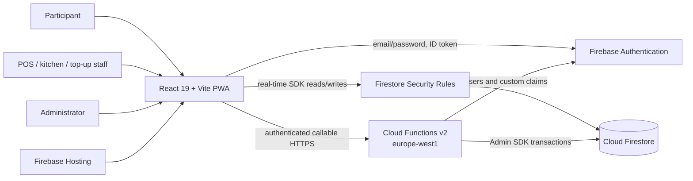

# Project Architecture & Onboarding Guide

## What this project is

Kasszás Erzsi 2.0 is a Hungarian, event-scoped cashless point-of-sale and catering application. It is designed for camps or similar temporary events where participants preload Hungarian-forint balances, identify themselves with QR credentials, buy drinks and food at staffed counters, and follow food preparation from their own phones. Organizers manage the attendee directory, products, stock, accounts, deposits, event lifecycle, reporting, and the transfer of remaining balances to the next event.

**Confirmed:** the executable system is a React progressive web application backed by Firebase Authentication, Cloud Firestore, callable Cloud Functions, and Firebase Hosting. There is no conventional REST server. Most operational reads and writes go directly from browsers to Firestore and are authorized by Firestore Security Rules; selected identity, QR, top-up, bulk-adjustment, and event-closing operations run in Cloud Functions.

## Recommended reading order

Read this page for the 10–20 minute mental model, then [01-PROJECT-OVERVIEW.md](01-PROJECT-OVERVIEW.md) and [02-FUNCTIONALITY.md](02-FUNCTIONALITY.md) before the architecture/data/auth documents. Read [07-WORKFLOWS-AND-STATE-MACHINES.md](07-WORKFLOWS-AND-STATE-MACHINES.md) before modifying transactions, [09-DEVELOPMENT-GUIDE.md](09-DEVELOPMENT-GUIDE.md) before coding, and [10-ARCHITECTURAL-ASSESSMENT.md](10-ARCHITECTURAL-ASSESSMENT.md) before designing substantial changes.

## Who uses it

| Actor | Role | Main intent |
| --- | --- | --- |
| Participant/guest | `user` | Browse the read-only menu, join the current event, see balance and orders, follow food status, claim a QR code |
| Temporary counter worker | `pos_staff` | Identify guests, sell/refund, operate the kitchen board |
| Staff/organizer | `staff` | All counter work plus people and catalog/stock management |
| Head counter worker (Főbüfé) | `head_pos` | Use POS, manage the catalog, and view event statistics |
| Top-up worker | `topup_staff` | Find participants and add positive balance |
| Administrator | `admin` | Full event, account, QR, balance, reporting, and audit administration |

## Core capabilities

- Email/password authentication and role-bearing Firebase ID tokens.
- One active event at a time, with draft/active/closed lifecycle and catalog cloning.
- Attendee import, soft deletion, account linking by a normalized Shibboleth identifier, and balance carryover.
- Four-digit QR credential pool, assignment, self-claim, revocation, and POS resolution.
- POS baskets with per-device leases, product barcode scanning, modifiers, DRS deposits, bottle returns, reusable-cup returns, atomic checkout, stock consumption, and refunds.
- A live kitchen display split into burger, gyros, pizza, and other stations.
- Product, barcode, modifier-template, recipe, stock, and stock-movement management, including Excel import/export.
- Ledger and audit records, DRS/repohár tracking, and event analytics/CSV export.
- Installable PWA behavior in production, with staging service workers deliberately disabled.

## How the system works

The browser authenticates with Firebase Auth, subscribes to `system/runtime` to discover the active event, and then opens real-time Firestore listeners for the current screen. Firestore Rules are the primary backend boundary for direct database operations. Callable Functions use Admin SDK transactions for operations needing Auth administration, concealed QR mappings, or stronger orchestration. Firestore transactions atomically couple balance, order, stock, ledger, audit, and basket changes during checkout and refund.

### Key architectural facts

- Firestore is simultaneously database, real-time transport, and most of the application API.
- Business logic is split between browser services and one Cloud Functions module.
- Authorization must be reviewed in both `firestore.rules` and callable claim checks.
- The authoritative balance is mutable on the person document; ledger/audit records explain it.
- Event scoping is pervasive, while accounts, runtime, and carryover are global.

## System architecture

The frontend is both presentation tier and much of the application/service tier. Firestore transactions in `src/features/**/**Service.js` contain important business behavior; Cloud Functions in `functions/index.js` contain the rest. Rules in `firestore.rules` are therefore as architecturally important as either code layer.

## Most important workflows

1. **Event setup:** an admin creates a draft or active event, optionally clones the prior catalog, imports people/products/stock, creates QR credentials, and assigns roles.
2. **Participant onboarding:** a guest registers, joins the active event by Shibboleth, optionally receives unapplied carryover, and claims or receives a QR credential.
3. **Sale:** staff scans/searches a participant, acquires a basket lease, adds products and returns, then finalizes one Firestore transaction that creates the order and ledger/audit records, updates balance and stock, and deletes the basket.
4. **Kitchen:** food lines become station tickets; staff advances station state and the order-level state is derived from the least advanced station.
5. **Event close:** an admin resolves missing/duplicate Shibboleths, then a Cloud Function writes one carryover record per participant, closes the event, and clears the active-event pointer atomically.

## Core domain model

An `Event` owns attendees (`Person`), products, QR credentials, baskets, orders, ledger entries, audit logs, returns, and stock. An Auth `Account` may link to at most one person per event through `AccountEventLink`. A person owns the authoritative balance. Orders snapshot names, prices, customizations, and stock consumption so later catalog changes do not rewrite history. `CarryoverBalance`, keyed by normalized Shibboleth, connects otherwise separate event data sets.

## Technology stack

| Technology | Use |
| --- | --- |
| React 19 / React Router 7 | Single-page UI, route guards, context providers, real-time views |
| Vite 7 / vite-plugin-pwa | Builds, dev server, manifest and Workbox service worker |
| Firebase JS SDK 12 | Auth, Firestore listeners/transactions, callable Functions |
| Firebase Admin / Functions v2 | Auth administration and privileged transactional workflows |
| Cloud Firestore | Document database, real-time transport, concurrency control |
| Recharts | Event statistics visualizations |
| SheetJS (`xlsx`) | Browser-side Excel import/export |
| `qr-scanner` / `qrcode` | Camera/keyboard scanning and QR rendering |

## Repository orientation

- `src/app/`: provider composition, routes, client-side guards, navigation.
- `src/features/pos/`, `orders/`, `kitchen/`: the sale and fulfillment core.
- `src/features/people/`, `auth/`, `qr/`, `events/`: identity, participants, event lifecycle, carryover.
- `src/features/products/`, `modifiers/`, `stock/`: catalog and inventory.
- `src/features/admin/`: administrative workflows, analytics, audit UI.
- `src/lib/`: Firebase bootstrap, roles, paths, normalization, money/session helpers.
- `functions/index.js`: all callable backend operations in one module.
- `firestore.rules`, `firestore.indexes.json`: effective database API and query support.
- `tests/`: standalone unit, emulator, rule, staging, and QR/carryover scripts.
- `firebase.json`, `.firebaserc`, `.env*.example`: hosting, Firestore, Functions, and environment wiring.

## Deployment model

Production (`erzsi-2`) and staging (`erzsi-2-staging`) are separate Firebase projects selected through aliases and Vite modes. `npm run deploy:prod` or `deploy:staging` builds static assets and deploys Hosting, Rules, indexes, and Functions. Firestore is in `eur3`; Functions are in `europe-west1`. No CI/CD pipeline or infrastructure-as-code beyond Firebase configuration is present.

## Major architectural concerns

- **High:** linked participants can query every food order, including other participants' ticket contents and identity fields, because the guest queue calculation depends on `orders.hasFood == true` and Rules explicitly permit it.
- **High:** POS-capable clients may create/update/delete arbitrary order, basket, ledger, audit, and DRS documents; Rules validate roles but not the cross-document invariants enforced by UI transactions. A compromised staff session can bypass pricing and accounting logic.
- **High:** closing a large event uses one Firestore transaction and unbounded reads/writes; it will exceed Firestore transaction limits well below the function's apparent product scope.
- **Medium:** the application bundle is about 2.06 MB minified (about 588 KB gzip) and has no route-level code splitting.
- **Medium:** many real-time listeners are unbounded; `people` alone is silently capped at 500, while orders, ledger, audit, stock movements, and analytics are not paginated.
- **Medium:** business rules and station classification are duplicated between client models/services, UI, Functions, and test copies.

See [10-ARCHITECTURAL-ASSESSMENT.md](10-ARCHITECTURAL-ASSESSMENT.md) for evidence, severity, and recommended direction.

## Documentation map

1. [Project overview](01-PROJECT-OVERVIEW.md)
2. [Functionality](02-FUNCTIONALITY.md)
3. [Architecture](03-ARCHITECTURE.md)
4. [Data model](04-DATA-MODEL.md)
5. [API and integrations](05-API-AND-INTEGRATIONS.md)
6. [Authentication and permissions](06-AUTH-AND-PERMISSIONS.md)
7. [Workflows and state machines](07-WORKFLOWS-AND-STATE-MACHINES.md)
8. [Infrastructure and deployment](08-INFRASTRUCTURE-AND-DEPLOYMENT.md)
9. [Development guide](09-DEVELOPMENT-GUIDE.md)
10. [Architectural assessment](10-ARCHITECTURAL-ASSESSMENT.md)
11. [Glossary](11-GLOSSARY.md)
12. [Open questions](12-OPEN-QUESTIONS.md)

## Mental model for new developers

1. Everything operational is scoped beneath one event document.
2. `system/runtime.activeEventId` is the global switch that opens the working UI.
3. Auth accounts and event people are different entities; an event link joins them.
4. The person's `balance` is authoritative; the ledger is an append-oriented explanation, not the value source.
5. Shibboleth—not Auth UID—is the cross-event continuity key.
6. Four-digit numeric codes are reserved for person QR credentials; product barcodes must not be four digits.
7. The frontend talks directly to Firestore for most workflows.
8. Firestore Rules are the server-side authorization layer for those direct calls.
9. Callable Functions handle Auth administration, QR mapping, top-ups, account linking, bulk adjustments, and event closure.
10. Checkout and refund correctness comes from Firestore transactions.
11. An open basket is also a 45-second renewable per-device lease.
12. Orders snapshot line details, including modifiers and stock consumption.
13. Food status is stored both per station and as a derived legacy overall status.
14. DRS is 50 HUF per bottle; reusable-cup returns are 1,000 HUF and tracked as synthetic order lines.
15. A configured event may permit exactly one purchase that crosses a non-negative balance below zero; another positive purchase is then blocked.
16. Event close is the only operation that advances balances into the global carryover collection.
17. The statistics page recomputes in the browser from live raw collections and is available to admins and Főbüfé.
18. Production PWA caching is enabled; staging unregisters service workers.
19. Existing source changes were present during this analysis; documentation describes the inspected working tree, not necessarily the last commit.
20. For sensitive changes, review service code, Functions, and Rules together.

## If you remember only five things

1. This is a Firebase client-heavy POS, not a REST-backed application.
2. `Person`, `Account`, and `AccountEventLink` are distinct and must stay consistent.
3. Checkout is a multi-document Firestore transaction; never update only the order or only the balance.
4. Authorization is split among route guards, Rules, and callable Functions; only the latter two are security boundaries.
5. The biggest current risks are guest food-order data exposure, overly broad staff writes, and event-close transaction scale.
